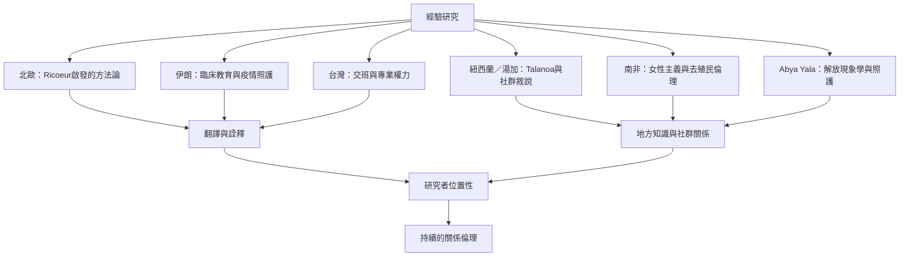

詮釋現象學源自歐洲哲學，但其研究實踐分布於醫療、教育、社會工作和社群研究等不同場域。不同地方的語言、制度、宗教、工作安排與知識傳統會改變經驗如何被說出和理解。全球比較不應只把不同地區當作案例標籤，而應分析研究方法如何回應地方知識、翻譯、權力和倫理。

## 思與行
* 比較不同地區的研究時，先問方法是否相同、資料如何生成、參與者由誰招募、語言如何處理。
* 對去殖民與原住民族研究保持謙遜：不把地方實踐抽離其文化脈絡，也不聲稱某個研究計畫已經證明整個社群的經驗。
* 將研究倫理理解為持續協商，讓參與者與社群能參與成果詮釋與使用。

## 參考
* 區域案例：[[伊朗護理學生的臨床工作經驗呈現關係與制度壓力]]、[[伊朗新冠照護者的經驗交織倫理困境與情緒震盪]]、[[台灣護理交班同時傳遞照護責任與權力關係]]、[[紐西蘭研究計畫以Talanoa連結湯加糖尿病經驗與詮釋現象學]]、[[南非女性主義研究把倫理從程序提升為關係責任]]、[[Abya Yala護理論述把照護經驗連結反抗與解放]]。
* 方法與倫理議題：[[跨語言訪談的意義會在翻譯過程中被重新詮釋]]、[[2026研究提醒翻譯是知識生產的詮釋實作]]、[[地方知識與社群關係應共同塑造研究方法]]及[[研究倫理是持續的關係責任而非一次性核准]]。
