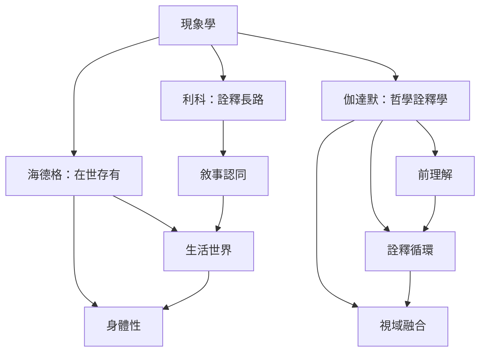

詮釋現象學的核心不是「把主觀意見整理成主題」，而是追問人如何在歷史、語言、身體與世界中理解自身經驗。海德格凸顯[[term/在世存有表示人原本就在世界關係之中|在世存有]]與[[term/生活世界是經驗得以顯現的意義地平|生活世界]]；伽達默說明[[term/前理解是理解得以開始的預先結構|前理解]]、[[term/詮釋循環是整體與部分互相校正的理解歷程|詮釋循環]]和[[term/視域融合是在對話中形成新的理解可能|視域融合]]；利科則把[[term/敘事認同是在故事中理解自身的持續性|敘事認同]]與符號詮釋帶入自我理解。這些路徑互相對話，但不應被壓成一種單一理論。

## 思與行
* 閱讀順序可先從[[term/現象學研究經驗如何向意識顯現|現象學]]和[[term/詮釋學探討意義如何被理解與解釋|詮釋學]]的概念界線開始，再分別讀海德格、伽達默與利科。
* 每讀一位哲學家，挑一段日常經驗試著用其概念重新描述，檢查理論究竟增加了什麼理解。

## 參考
* 哲學原典的二手導讀：[[海德格把理解奠基於人在世存有]]、[[伽達默指出理解總已受歷史處境形塑]]、[[利科以詮釋長路連結符號敘事與自我理解]]。
* 重要概念亦見[[term/生活經驗是人從自身位置活過的經驗|生活經驗]]、[[term/生活世界是經驗得以顯現的意義地平|生活世界]]、[[term/身體性指身體是經驗世界的方式|身體性]]、[[term/前理解是理解得以開始的預先結構|前理解]]、[[term/視域融合是在對話中形成新的理解可能|視域融合]]、[[term/詮釋循環是整體與部分互相校正的理解歷程|詮釋循環]]與[[term/敘事認同是在故事中理解自身的持續性|敘事認同]]。
