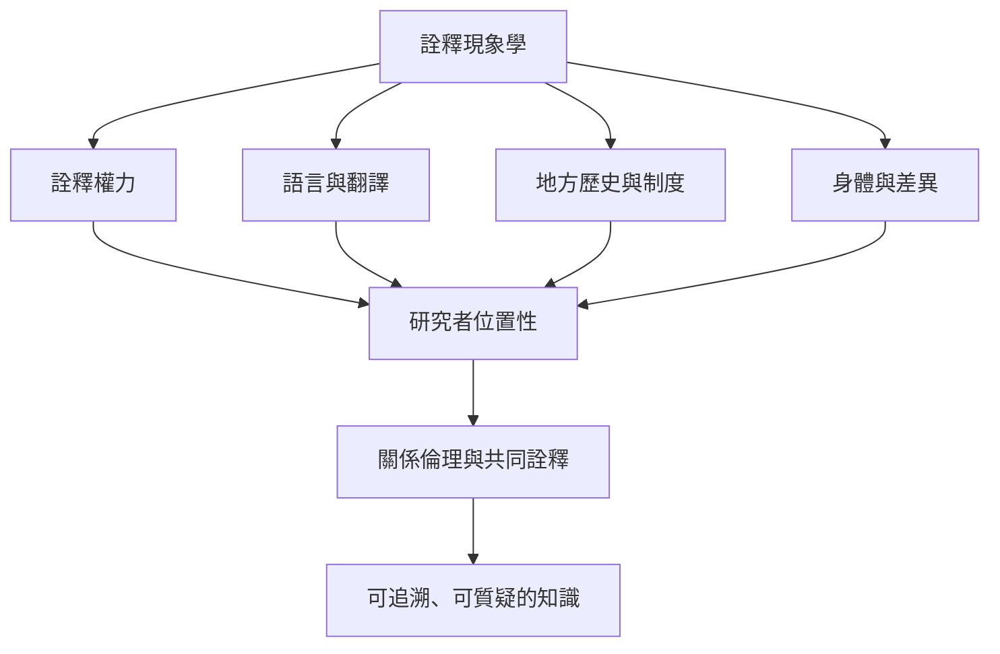

詮釋現象學的力量在於看見經驗的深層意義，但也有風險：研究者可能把自身理論投射到參與者身上、把差異過度整合、把個人困境心理化，或把西方哲學概念當成普遍框架。批判性研究因此需要把[[term/研究者位置性說明研究者如何處於權力與知識關係|研究者位置性]]、[[note/語言翻譯不是透明管道而是意義生成的環節|跨語言詮釋]]、[[note/研究倫理是持續的關係責任而非一次性核准|研究倫理]]和地方歷史納入同一分析過程。

## 思與行
* 對照不同群體對同一現象的命名方式，檢查學術詞彙是否遮蔽了地方概念。
* 研究報告應揭露研究者的角色與翻譯選擇，並呈現無法解決的歧義。
* 把批判理論當作開啟問題的工具，而不是用來替參與者預先發言。

## 參考
* [[詮釋現象學必須讓地方歷史與權力進入分析]]、[[語言翻譯不是透明管道而是意義生成的環節]]、[[詮釋不是任意投射而是受材料約束的論證]]及[[研究倫理是持續的關係責任而非一次性核准]]。
