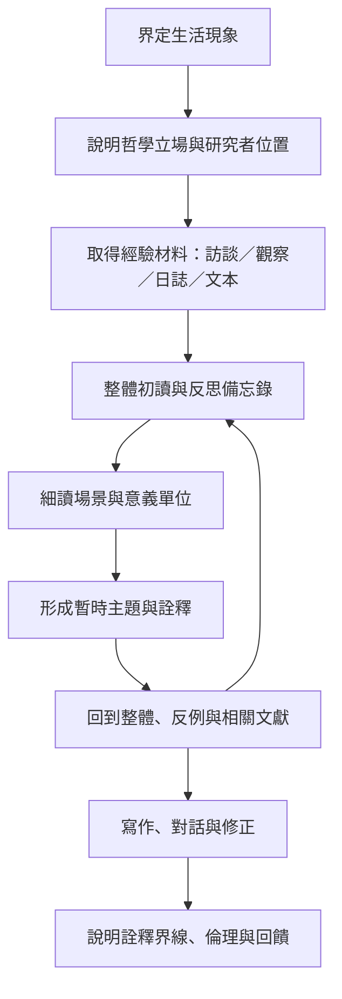

研究實作從一個值得追問的生活現象開始，經由敘說、觀察、日誌或文本取得經驗材料，再在整體閱讀、細節分析與反思寫作之間往返。不同傳統有不同分析流程：van Manen 強調直接面向現象的細緻寫作；Ricoeur 啟發的現象學詮釋方法常採初讀、結構分析與全面理解；IPA 則以個案取向和雙重詮釋為特色。研究者必須交代自己的方法來源，不能把這些流程混成一張通用清單。

## 思與行
* 可從 [[idea/以赤腳步行的日常場景研究身體如何理解地方]]、[[idea/用共同閱讀與對話觀察視域如何彼此改變]]、[[idea/以訪談重建照顧關係中的責任如何流動]]、[[idea/用生活日誌追蹤同一經驗如何隨時間改變意義]] 等微型研究開始。
* 研究計畫中分別寫出哲學立場、資料生成方式、分析步驟和品質論證，不以一段模糊的「採現象學分析」帶過。
* 重要的詮釋主張需能追溯到材料；若使用哲學概念，說明它如何促成新的理解。
* 在[[term/研究者位置性說明研究者如何處於權力與知識關係|研究者位置性]]、[[term/雙重詮釋是研究者理解參與者如何理解自己|雙重詮釋]]和[[term/詮釋循環是整體與部分互相校正的理解歷程|詮釋循環]]之間建立自我檢查機制。

## 參考
* [[van Manen以寫作與反思探究生活經驗]]、[[Ricoeur啟發的現象學詮釋方法從整體閱讀走向結構分析]]、[[三階段閱讀讓研究者在初步理解與整體詮釋間往返]]及[[IPA研究個人如何理解重大生命經驗]]。
* 研究品質與界線見[[詮釋不是任意投射而是受材料約束的論證]]、[[寫作本身就是現象學分析的一部分]]及[[詮釋現象學與IPA相鄰但不等同]]。
