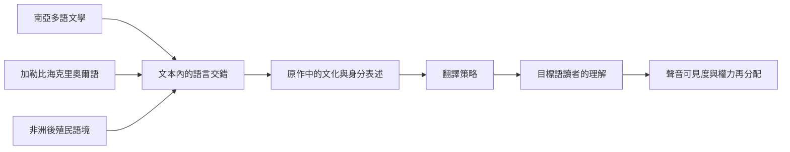

世界文學中的異質語會因殖民歷史、語言政策、遷移、出版市場與翻譯制度而呈現不同面貌。南亞作品可能在英語與多種地方語言間交錯；加勒比海小說會運用克里奧爾語與語碼轉換；非洲文學翻譯則需處理殖民與後殖民語言階序。翻譯者又會在新語言市場重新安排原作中的聲音。

## 思與行
* 比較[[阿蘭達蒂羅伊以語言選擇呈現印度社會中的階序與抵抗]]、[[加勒比海小說翻譯研究以譯者訪談揭示文化聲音如何被重述]]與[[非洲文學翻譯必須面對殖民歷史與多語資源之間的張力]]。
* 讀譯本時保留原文對照，連結[[翻譯不是中立搬運而是重新分配文本中的聲音權重]]。

## 參考
* [[文學翻譯若抹平語言差異也會改寫作品中的權力關係]]；[[後殖民文學的多語混雜挑戰把文化想像成封閉整體的翻譯觀]]。
