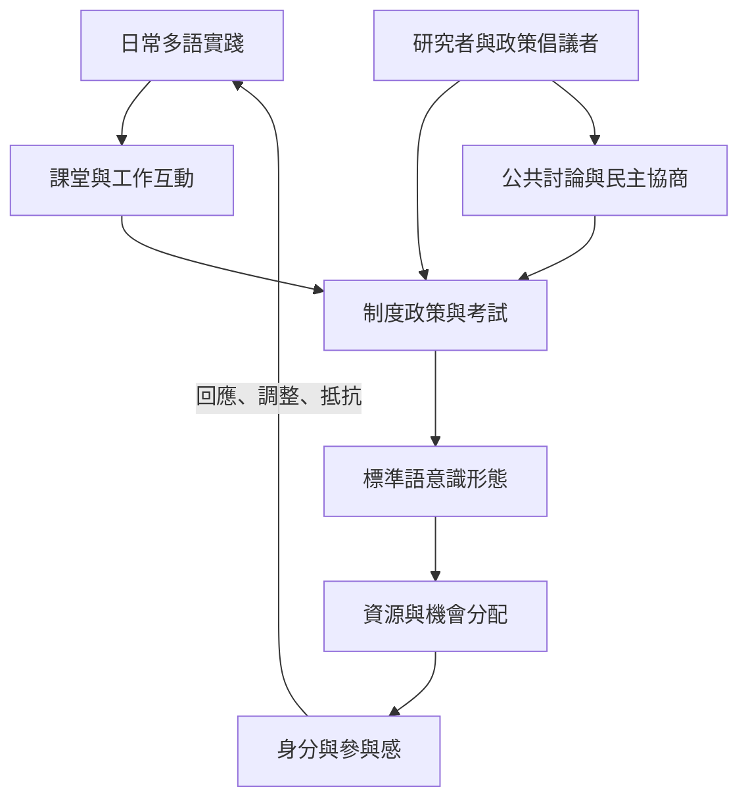

異質語不是只存在於文學作品，也呈現在學校、行政、媒體與專業制度。日常互動可以靈活運用多種語言資源，正式政策卻可能只認可一種標準形式；語言評量因而決定哪些能力能被看見、哪些表達被視為偏差。

## 思與行
* 比較[[南非城鎮小學的課堂多語實踐與單語政策形成衝突]]與[[大學英語課的異質語教學介入在部分學習指標上優於單語教學]]，看不同教育環境中政策與實踐的差異。
* 閱讀[[異質語教育倡議不能用學術正確性取代公共政策辯論]]，避免以單一研究結果決定複雜政策。

## 參考
* [[語言標準化會把特定群體的語言習慣自然化為普遍規範]]；[[課堂中的語言資源與學校制度規範可能朝相反方向運作]]。
