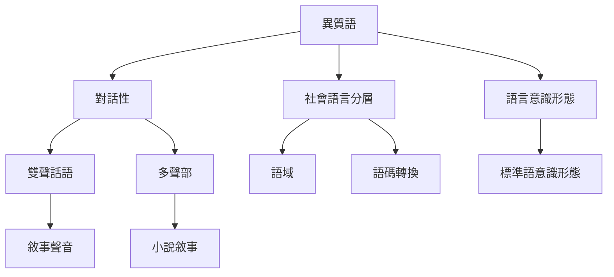

異質語的核心是語言內部的社會分層，以及這些話語形式彼此間的回應、競逐與重組。它與對話性、雙聲話語、多聲部和語言意識形態緊密相關，但各自回答不同問題：有哪些社會語言、它們如何互動、文本如何容納多個聲音，以及權力如何評價這些聲音。

## 思與行
* 建議先讀[[巴赫汀以異質語說明語言內部始終存在社會觀點的競逐]]，再讀[[異質語的差異在於語言形式同時標示社會位置與意識形態]]。
* 用[[對話性使每個言說都回應並預期其他言說]]與[[雙聲話語讓同一句話同時承載說話者與引用者的意圖]]分析具體文本。

## 參考
* [[敘事學將異質語理解為文本中可被聽見的多重聲音]]；[[異質語表演讓身分政治在具體互動中顯形]]。
