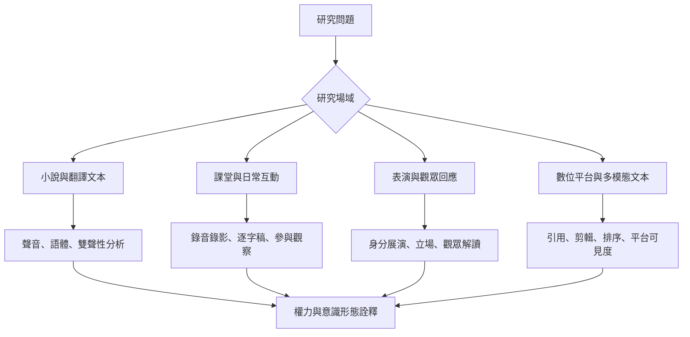

異質語研究可從細讀小說、分析敘事聲音，延伸到課堂錄影、逐字稿、表演民族誌與數位文本分析。方法選擇會影響研究者能看見哪些聲音，因此必須公開資料產生、轉錄、分類與詮釋的決策。

## 思與行
* 先讀[[香港雙語課堂的話語框架顯示語言選擇也在管理參與關係]]與[[小學生數位文本把家庭記憶同儕與流行文化聲音帶入課堂]]，比較不同研究資料如何生成。
* 使用[[研究者如何轉錄對話會改變可見的異質語證據]]檢查自己的方法偏差。

## 參考
* [[異質語表演讓身分政治在具體互動中顯形]]；[[數位文本讓日常使用者重新編排家庭媒體與制度的多重聲音]]。
