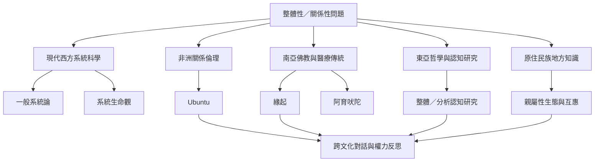

整體性思想並非由單一文明或單一學科發明。現代系統理論、南非思想中的 Ubuntu、印度佛教緣起、南亞阿育吠陀、東亞哲學與認知研究、原住民族關係世界觀，都能提供不同的關係性視角；它們的歷史目標、形上學與實踐方式並不相同，不能全部歸類為同一種「整體論」。

## 概念連結
[[整體論 Holism]]、[[一般系統論 General systems theory]]、[[Ubuntu]]、[[緣起 Dependent origination]]、[[阿育吠陀 Ayurveda]]、[[關係本體論 Relational ontology]]、[[相互依存 Interdependence]]。

相關永久筆記：[[文化認知差異是研究趨勢而不是文明本質]]、[[整體論需要對自身的權力位置保持反思]]、[[文化尊重與療效證據是兩個不同問題]]。
