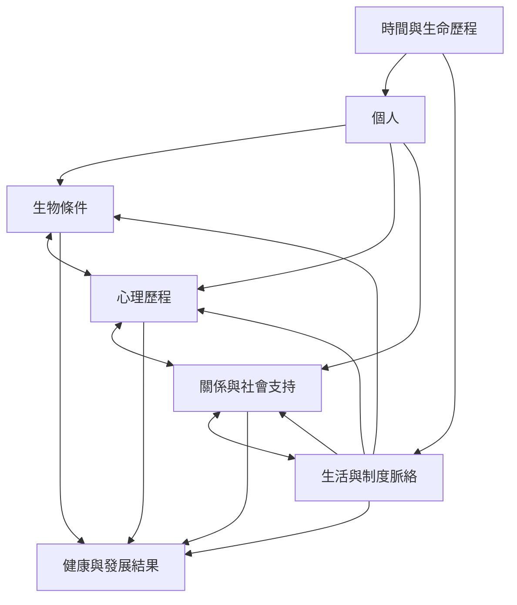

健康與發展是整體性研究的重要領域：身體、心理、社會關係、環境與時間彼此作用。但整體模型若要具有解釋力，必須提出具體機制與證據，而不能只是把所有因素一併列入。

## 概念連結
[[生物心理社會模型 Biopsychosocial model]]、[[多層次解釋 Multilevel explanation]]、[[同一健康 One Health]]、[[阿育吠陀 Ayurveda]]、[[循證醫學 Evidence-based medicine]]、[[整體論 Holism]]。

相關永久筆記：[[整體健康模型必須提出可檢驗的因果路徑]]、[[人的發展嵌在多層環境與時間之中]]、[[文化尊重與療效證據是兩個不同問題]]。
