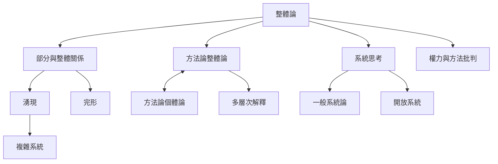

整體論不是一套單一教條，而是圍繞部分、關係、整體、層次與解釋方式展開的一組問題。此圖由概念定義、方法論爭論到系統科學，呈現整體理解如何與分析方法互補，也標出整體論可能遇到的權力及證據問題。

## 概念連結
[[整體論 Holism]]、[[還原論 Reductionism]]、[[湧現 Emergence]]、[[系統思考 Systems thinking]]、[[一般系統論 General systems theory]]、[[多層次解釋 Multilevel explanation]]、[[方法論整體論 Methodological holism]]、[[方法論個體論 Methodological individualism]]、[[複雜系統 Complex system]]、[[自組織 Self-organization]]。

相關永久筆記：[[整體論最好的形式是多層次解釋而不是反對分析]]、[[部分的性質會隨其所處關係而改變]]、[[湧現說明系統層次可能具有不能由簡單加總預測的性質]]、[[跨領域類比必須保留機制與尺度差異]]。
