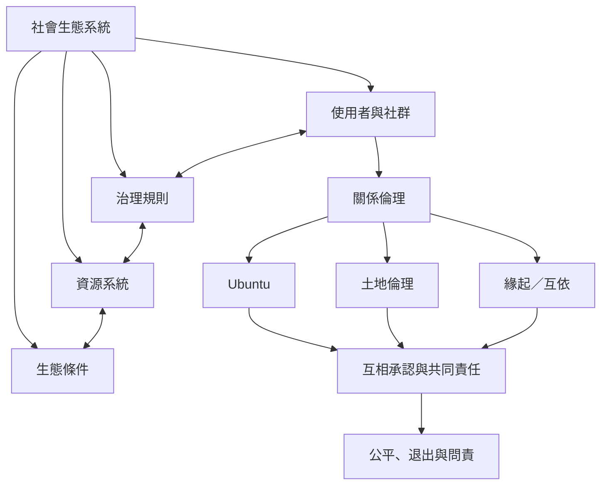

社會與生態並非兩個互不相干的領域。資源、使用者、治理規則、文化倫理與生態條件共同形成社會生態系統。整體實踐既要重視互賴與共同責任，也要避免以共同體或整體利益壓抑個體權利。

## 概念連結
[[社會生態系統 Social-ecological system]]、[[相互依存 Interdependence]]、[[關係本體論 Relational ontology]]、[[Ubuntu]]、[[緣起 Dependent origination]]、[[土地倫理 Land ethic]]、[[同一健康 One Health]]。

相關永久筆記：[[生態倫理把人類放回生命共同體之中]]、[[關係性倫理不能被簡化成群體服從]]、[[整體論需要對自身的權力位置保持反思]]。
