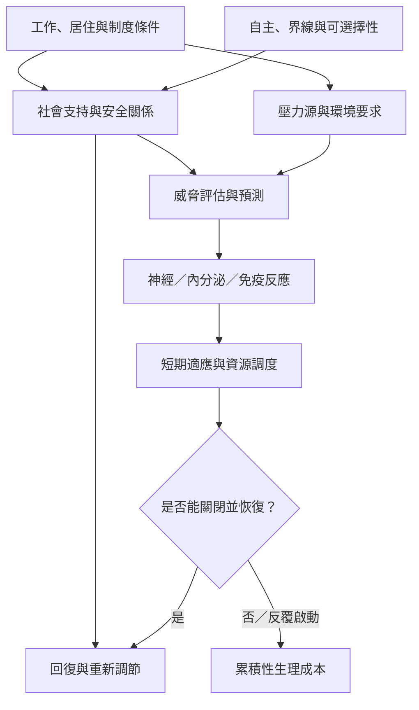

壓力調節並非只發生在個體內部。生理系統的啟動與恢復會受到關係、環境與制度影響。社會基線理論提供一種研究視角，指出熟悉且可預期的他人可能影響威脅處理與努力成本；應同時考慮關係品質、權力、界線與個體自主。

主要筆記：[[壓力反應短期有適應價值但長期可能累積成本]]、[[社會支持可能降低個體調節威脅時的資源消耗]]、[[調節環境需要安全感也需要個體自主]]、[[把失衡視為系統訊號而不是個人道德失敗]]、[[共同生活的設計可以降低不必要的調節成本]]、[[為日常預留恢復時間比持續提高效率更接近長期適應]]。

文獻：[[McEwen把異穩態負荷連結到壓力適應與疾病風險]]、[[Coan與Sbarra以社會基線理論研究人際關係如何調節風險與努力]]。

概念：[[異穩態負荷（Allostatic load）]]、[[社會基線理論（Social Baseline Theory）]]、[[異穩態（Allostasis）]]。

本書入口：[[Homeostasis]]。
