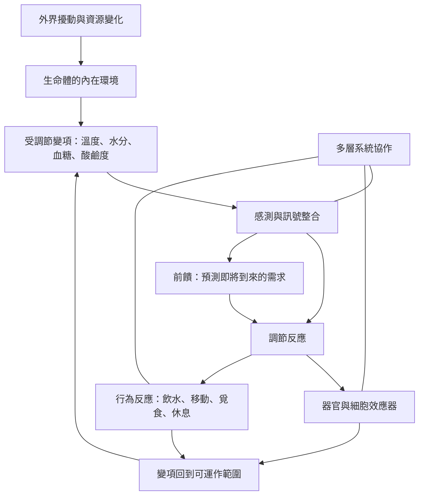

恆定的核心問題是：生命體如何在外界持續變動、物質與能量不斷交換的情況下，維持細胞運作所需的內部條件？本圖以內在環境、調節迴路、多層系統與具體生理案例為主軸。閱讀時可先掌握受調節變項，再理解感測、整合、效應與行為如何共同作用。

核心讀法：[[恆定描述的是受調節的內部條件而不是一套單一器官]]、[[恆定是動態穩定而不是身體完全不變]]、[[生物是開放系統而不是封閉容器]]、[[負回饋能抵銷偏離但不是全部調節機制]]、[[生理調節是多層系統協作的結果]]。

具體案例：[[滲透壓調節把腦與腎臟連成水分控制軸]]、[[行為本身也是恆定系統的效應器]]、[[生物的恆定範圍會隨物種與生態位而不同]]。

重要文獻：[[Claude_Bernard的內在環境概念奠定恆定研究的思想基礎]]、[[Cannon在1929年以恆定概念整合身體的協調調節]]、[[Cannon以身體的智慧整理多系統如何維持生命條件]]、[[Billman回顧恆定如何成為整合生理學的核心原理]]、[[2026年的恆定教學論文整理概念演變與未來教學方向]]。

相關概念：[[恆定（Homeostasis）]]、[[內在環境（Internal milieu）]]、[[負回饋（Negative feedback）]]、[[前饋控制（Feedforward control）]]、[[效應器（Effector）]]、[[穩態（Steady state）]]。

本書入口：[[Homeostasis]]。
