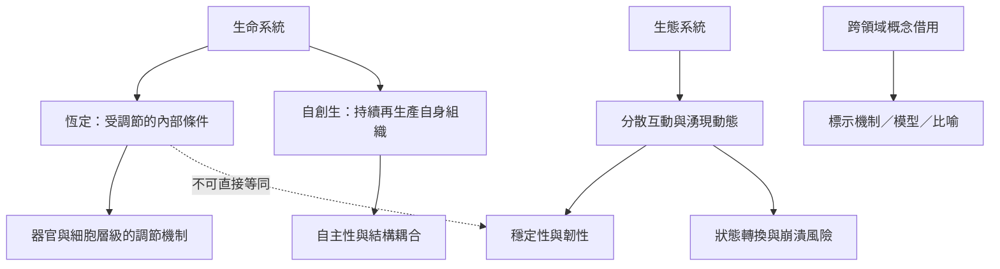

從生理恆定走向生態學與社會理論時，最重要的是辨識概念層次。生態系有回饋、穩定性與韌性，但不能直接假設它像動物身體一樣具有協調的恆定控制器。自創生則提供另一條理論路徑，關注生命如何透過自身組織持續再生產自身。

主要筆記：[[生命的自主性來自持續重建自身的組織]]、[[生態韌性與生理恆定是不同層次的系統概念]]、[[跨領域借用恆定一詞必須清楚標示比喻邊界]]、[[生物的恆定範圍會隨物種與生態位而不同]]、[[以多樣性與冗餘設計社群而不是追求單一最佳解]]。

文獻：[[Maturana與Varela以自創生描述生命如何持續再生產自身]]、[[Holling區分生態系的穩定性與韌性]]、[[生態學者提醒生態系沒有像身體一樣的恆溫器]]、[[Bradshaw以脊椎動物生態生理學說明恆定的跨物種意義]]。

概念：[[自創生（Autopoiesis）]]、[[韌性（Resilience）]]、[[穩定性（Stability）]]、[[自我調節（Self-regulation）]]。

本書入口：[[Homeostasis]]。
