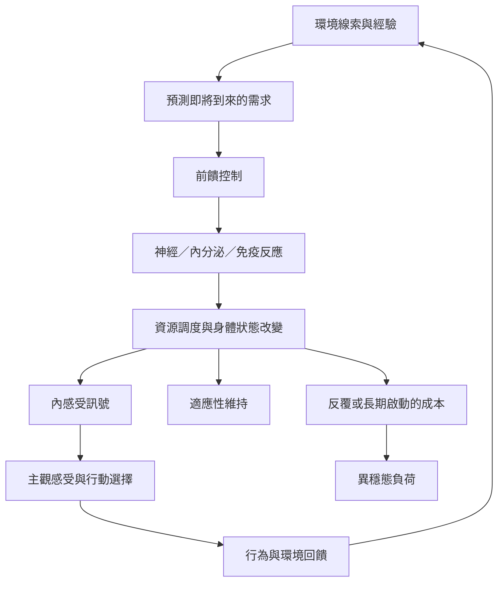

恆定調節不只在偏離發生後才修正，也會利用預期、學習與內感受訊號調度身體資源。此圖將異穩態、前饋、內感受與壓力負荷放在同一脈絡；閱讀時必須保留 allostasis 定義尚有歧異、預測性內感受仍有模型爭論的事實。

主要筆記：[[異穩態描述生命透過改變來維持穩定]]、[[預測性調節讓身體能在需求到來前先行準備]]、[[生理設定點常是可移動的調節參考而非固定常數]]、[[壓力反應短期有適應價值但長期可能累積成本]]、[[身體感受是內在調節狀態通往意識的訊號]]、[[預測與感覺共同形塑內感受經驗]]。

文獻與演講：[[恆定與異穩態應被視為可比較的生理調節模型]]、[[McEwen把異穩態負荷連結到壓力適應與疾病風險]]、[[Sterling以預測性調節重新思考身體如何維持穩定]]、[[Craig把內感受定位為身體狀態進入主觀感受的通道]]、[[Barrett與Simmons提出大腦會預測內在身體狀態]]、[[Lisa Feldman Barrett在耶魯公開演講中介紹身體預算與預測調節]]。

概念：[[異穩態（Allostasis）]]、[[異穩態負荷（Allostatic load）]]、[[內感受（Interoception）]]、[[前饋控制（Feedforward control）]]、[[設定點（Set point）]]。

本書入口：[[Homeostasis]]。
