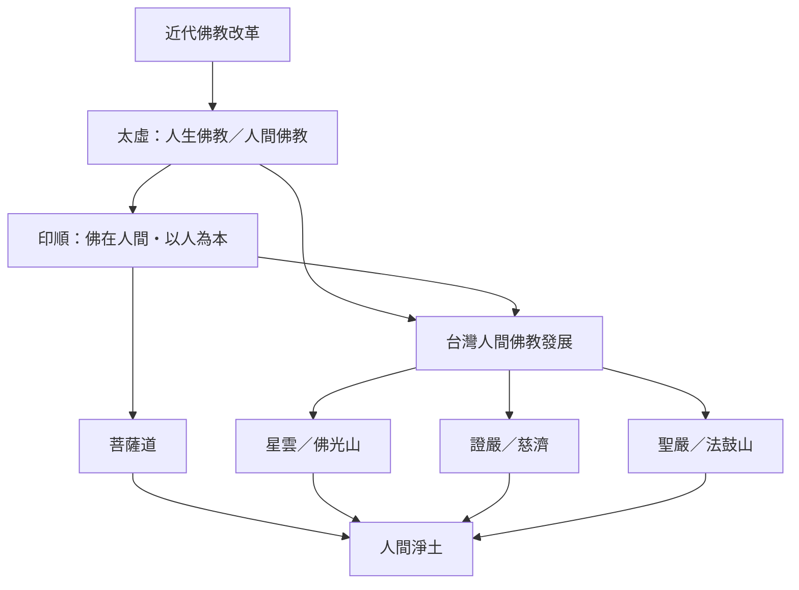

本圖整理太虛、印順及台灣主要人間佛教人物的思想關係，並將「人生佛教」「人間淨土」「菩薩道」與現代佛教改革連接。這不是單線傳承圖，而是用來辨識思想影響、詮釋差異與共同問題的閱讀地圖。

核心概念：[[人間佛教]]、[[人生佛教]]、[[人間淨土]]、[[太虛]]、[[印順]]、[[星雲]]、[[證嚴]]、[[聖嚴]]、[[菩薩道]]。

永久筆記：[[note/人間佛教是一條多源而非單一的現代佛教譜系]]、[[note/人間佛教的核心轉向是把解脫理想放回現實人生]]、[[note/人間淨土是一項需要制度與關係共同支持的實踐理想]]

## 思與行
- 以此圖安排閱讀順序，遇到新研究時，先判斷它補充的是歷史、概念、組織、地方經驗或批判視角。
- 每次新增節點，都檢查是否需要補上相反觀點或尚未被代表的地區。

## 參考
- 地圖入口：[[人間佛教]]
- 地圖入口：[[人生佛教]]
- 地圖入口：[[人間淨土]]
- 地圖入口：[[菩薩道]]
- 全書導讀：[[Humanistic_Buddhism]]
