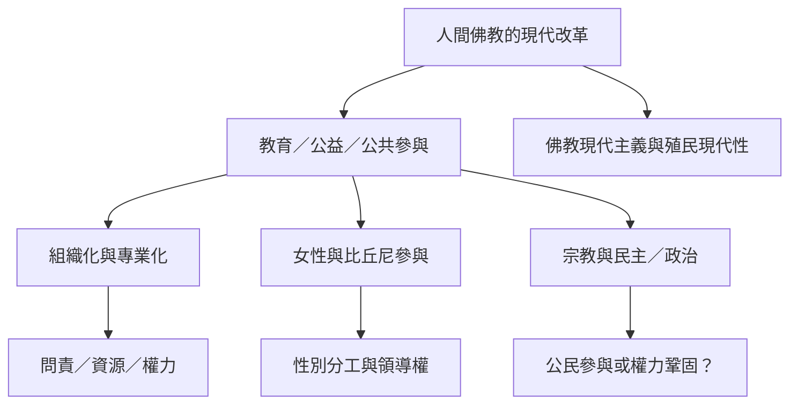

本圖呈現人間佛教的改革成就與必須持續檢視的張力：現代化與殖民性、公益規模與組織權力、女性參與與性別平等、宗教公共性與政治治理。

核心概念：[[佛教現代主義]]、[[殖民現代性]]、[[宗教與政治]]、[[宗教與民主]]、[[性別平等]]、[[權力分析]]、[[慈善專業化]]。

永久筆記：[[note/宗教組織參與民主社會仍需接受民主治理的檢驗]]、[[note/女性的公共服務成就不能取代對宗教權力平等的追問]]、[[note/慈善組織的規模成長不能直接代表修行品質提升]]

## 思與行
- 以此圖安排閱讀順序，遇到新研究時，先判斷它補充的是歷史、概念、組織、地方經驗或批判視角。
- 每次新增節點，都檢查是否需要補上相反觀點或尚未被代表的地區。

## 參考
- 地圖入口：[[佛教現代主義]]
- 地圖入口：[[權力分析]]
- 地圖入口：[[性別平等]]
- 地圖入口：[[宗教與民主]]
- 全書導讀：[[Humanistic_Buddhism]]
