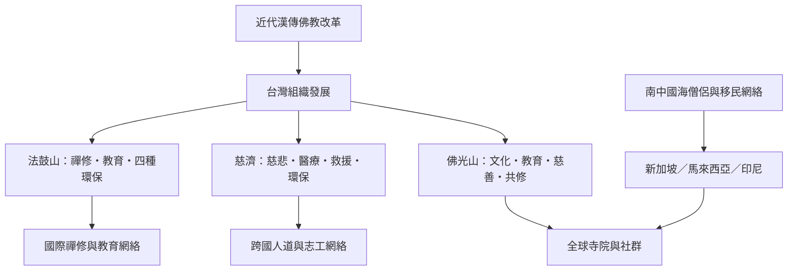

本圖將台灣主要組織與南中國海、東南亞及全球網絡放在同一視野，關注僧侶移動、移民社群、機構建立與地方化翻譯。

核心概念：[[佛光山]]、[[慈濟]]、[[法鼓山]]、[[跨國佛教]]、[[華人離散佛教]]、[[東南亞佛教]]。

永久筆記：[[note/跨國佛教的傳播是一種地方化翻譯而非單向輸出]]、[[note/全球人間佛教研究必須同時閱讀內部敘事與外部學術分析]]

## 思與行
- 以此圖安排閱讀順序，遇到新研究時，先判斷它補充的是歷史、概念、組織、地方經驗或批判視角。
- 每次新增節點，都檢查是否需要補上相反觀點或尚未被代表的地區。

## 參考
- 地圖入口：[[佛光山]]
- 地圖入口：[[慈濟]]
- 地圖入口：[[法鼓山]]
- 地圖入口：[[跨國佛教]]
- 全書導讀：[[Humanistic_Buddhism]]
