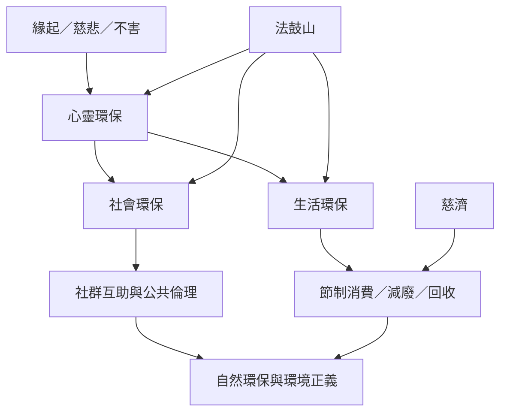

本圖聚焦慈濟與法鼓山的環境實踐，並延伸到跨地域佛教環境行動。核心問題是如何從心念與日常生活的節制，延伸到生態保護、氣候倡議與環境正義。

核心概念：[[四種環保]]、[[佛教環境倫理]]、[[緣起]]、[[不害]]、[[慈悲]]。

永久筆記：[[note/佛教環境倫理需要從個人節制擴展到結構性環境正義]]。

## 思與行
- 以此圖安排閱讀順序，遇到新研究時，先判斷它補充的是歷史、概念、組織、地方經驗或批判視角。
- 每次新增節點，都檢查是否需要補上相反觀點或尚未被代表的地區。

## 參考
- 地圖入口：[[四種環保]]
- 地圖入口：[[佛教環境倫理]]
- 地圖入口：[[慈悲]]
- 地圖入口：[[緣起]]
- 全書導讀：[[Humanistic_Buddhism]]
