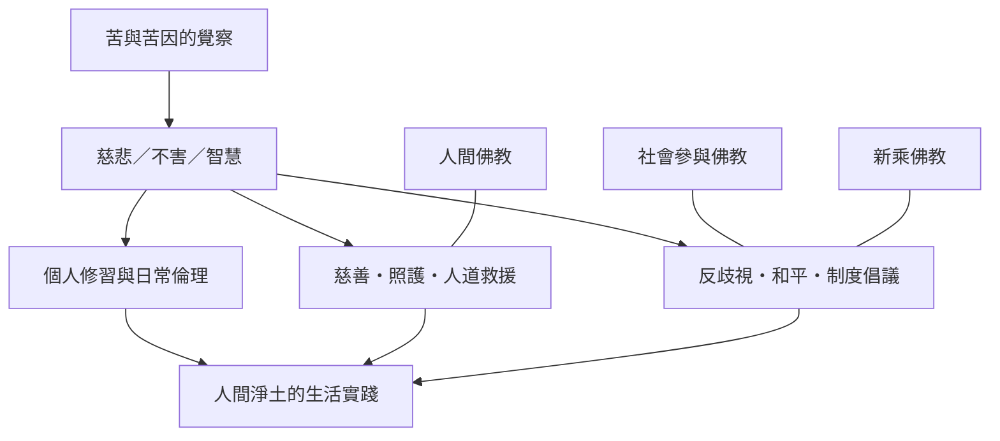

本圖把個人修習、慈悲倫理、社會服務與制度改革連接起來，並納入人間佛教、越南參與式佛教與印度新乘佛教的比較。

核心概念：[[慈悲]]、[[佛教慈善]]、[[人道行動]]、[[社會參與佛教]]、[[新乘佛教]]、[[宗教與社會正義]]。

永久筆記：[[note/慈悲只有轉化為尊重主體的行動才不會停留在施予者中心]]、[[note/人間佛教的公共倫理可用減苦程度而非組織聲量檢驗]]、[[note/人間佛教需要把自我淨化與集體行動放在同一張地圖上]]

## 思與行
- 以此圖安排閱讀順序，遇到新研究時，先判斷它補充的是歷史、概念、組織、地方經驗或批判視角。
- 每次新增節點，都檢查是否需要補上相反觀點或尚未被代表的地區。

## 參考
- 地圖入口：[[慈悲]]
- 地圖入口：[[社會參與佛教]]
- 地圖入口：[[人道行動]]
- 地圖入口：[[新乘佛教]]
- 全書導讀：[[Humanistic_Buddhism]]
