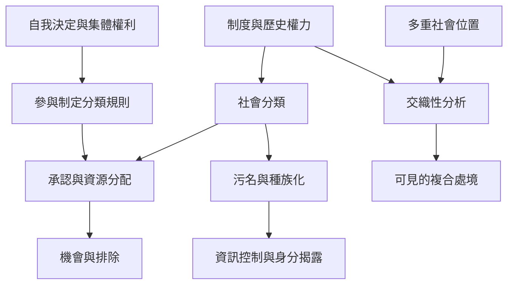

本圖把身分放在權力關係與制度分類中分析。分類可能決定誰被承認、誰取得資源，也可能產生污名與不平等；交織性則提醒多種權力關係會在具體制度中共同作用。

核心概念：[[交織性]]、[[污名]]、[[種族化]]、[[認定]]、[[自我決定]]、[[集體權利]]、[[身分揭露]]。

延伸閱讀：[[交織性揭示單一身分框架如何遮蔽多重權力位置]]、[[污名使人必須管理可見性資訊與社會互動]]、[[原住民族身分認同包含自我決定與集體權利]]、[[自我認定與外部歸類可能彼此衝突]]。
