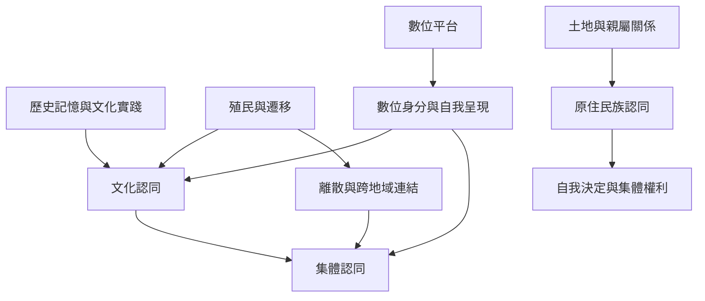

本圖整理文化、國族、原住民族、離散與數位身分的生成條件。歷史記憶與文化實踐提供連續性，遷移與殖民造成斷裂和混融，平台環境則改變身分呈現與觀眾結構。

核心概念：[[文化認同]]、[[族群認同]]、[[國家認同]]、[[離散]]、[[原住民族認同]]、[[whakapapa]]、[[whanaungatanga]]、[[數位身分]]。

延伸閱讀：[[文化認同在離散與再現中持續生成]]、[[拉美原住民族自我認定受語言膚色與國家歷史交織影響]]、[[毛利歸屬觀以世系與關係實踐連結人與地方]]、[[台灣身分認同調查適合觀察長期趨勢但不能取代個人脈絡]]。
