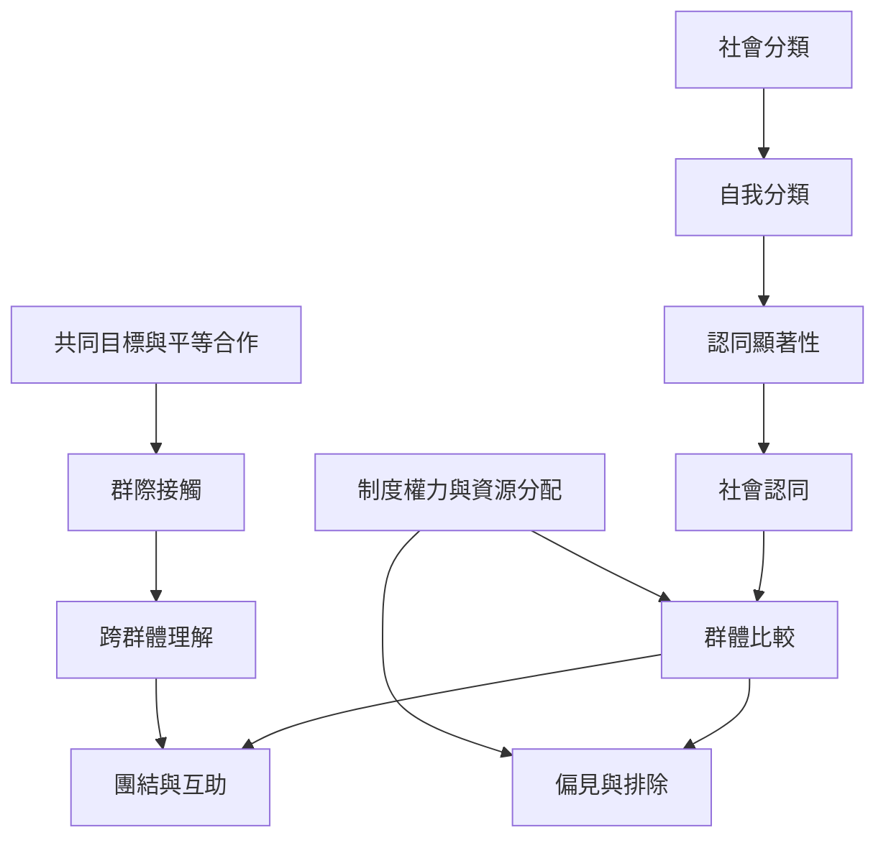

本圖整理社會認同、自我分類、群體比較與群際接觸如何相互連動。分類讓群體成為可辨識的心理對象，認同與比較則可能影響態度和行動；接觸與共同任務提供改變群際關係的可能，但不能替代制度改革。

核心概念：[[社會認同]]、[[自我分類]]、[[社會分類]]、[[認同顯著性]]、[[群體認同]]、[[群際接觸]]、[[集體認同]]。

延伸閱讀：[[社會認同理論說明群體歸屬如何影響自我評價與群際比較]]、[[自我分類理論說明情境如何改變顯著群體身分]]、[[群際接觸通常降低偏見但接觸品質與情境仍然重要]]、[[群體比較可能產生團結也可能強化排除]]。
