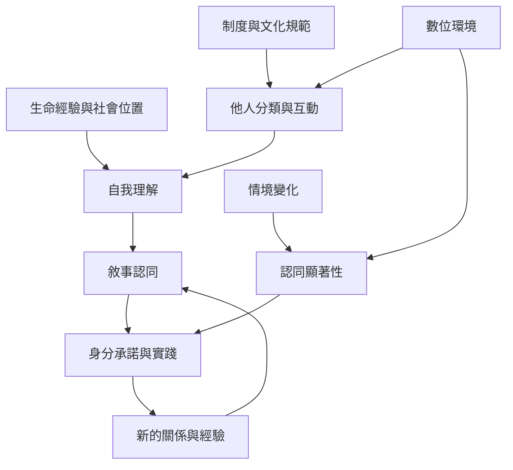

本圖呈現身分如何在自我理解、社會互動、角色實踐與生命敘事之間形成。身分不是一次決定的結果，而會隨情境顯著性、關係網絡與生命事件持續修訂。

核心概念：[[身分]]、[[個人認同]]、[[身分建構]]、[[認同顯著性]]、[[敘事認同]]、[[角色認同]]、[[歸屬感]]、[[數位身分]]。

延伸閱讀：[[身分建構研究已從人際互動延伸到集體與虛擬世界]]、[[敘事認同把生命經驗組織成持續演變的人生故事]]、[[數位環境透過選擇操弄喚起與整合影響身分發展]]、[[身分敘事保有連續感也能重新詮釋過去]]。
