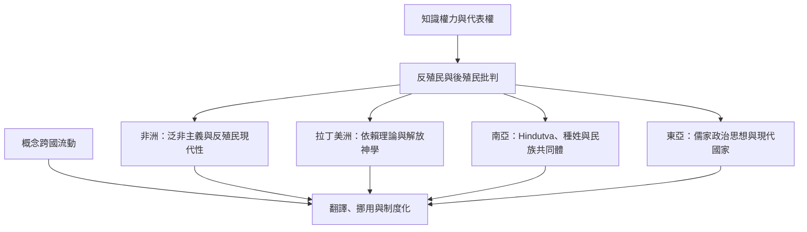

本地圖將歐洲理論與全球多地的思想生產並列。重點不在建立一套新的地域分類，而是看見概念如何在具體殖民、民族建構、階級與文化歷史中形成，並在跨國傳播時被重新編排。

## 參考
* [[非洲反殖民現代性不是冷戰兩極的附屬]]、[[拉美依賴理論以全球結構解釋欠發展]]、[[解放神學使受壓迫者成為知識與政治行動主體]]。
* [[印度教民族主義與種姓權力交織]]、[[東亞儒家政治思想在現代制度中持續被重構]]、[[東方主義展示知識分類如何支撐殖民權力]]。
* [[全球南方理論不是西方理論的地方案例]]。
* 概念詞條：[[東方主義]]、[[殖民主義]]、[[後殖民主義]]、[[全球南方]]、[[依賴理論]]、[[世界體系理論]]、[[民族主義]]、[[解放神學]]、[[交織性]]。
