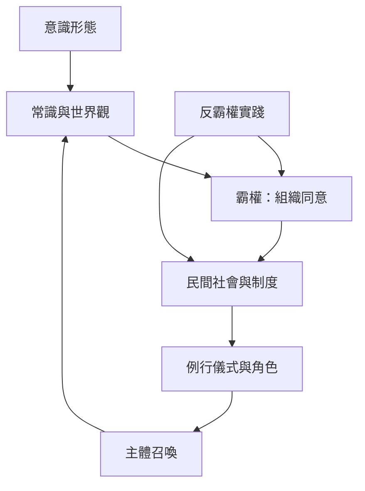

本地圖把意識形態從抽象思想連到日常制度。常識讓權力不必總以命令呈現；制度儀式使觀念成為可重複行動；主體召喚則說明個體如何在規範中理解自己。這些過程會相互強化，也可能在實踐中被改寫。

## 參考
* [[權力最穩固時常呈現為常識而非命令]]、[[霸權依賴同意組織而不只有強制]]。
* [[意識形態透過制度實踐與儀式再生產]]、[[公共與私人界線也能成為支配機制]]、[[把推薦系統視為會塑造公共注意力的意識形態基礎設施]]。
* 概念詞條：[[霸權]]、[[常識]]、[[公民社會]]、[[意識形態國家機器]]、[[主體召喚]]、[[主體性]]、[[制度再生產]]、[[社會再生產]]、[[反霸權]]。
