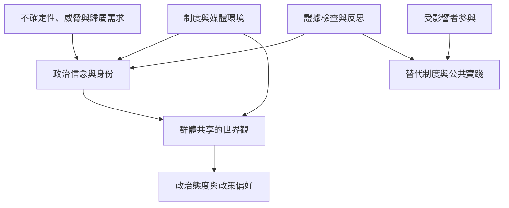

本地圖連結個體層次的認知／動機與社會層次的身份、媒體與制度。心理研究可說明人們為何被某些敘事吸引，但不能取代對制度、利益與歷史的分析。實作上，應將證據檢查、概念拆解與受影響者參與結合。

## 參考
* [[政治心理學解釋意識形態的認知與動機功能]]、[[政治信念也提供歸屬感與降低不確定性]]、[[氣候政策態度會沿文化意識形態產生分化]]。
* [[把公共主張拆成事實價值因果與方案四層]]、[[設計一場把立場放回生活經驗的低對抗對話]]、[[以受影響者共同定義問題取代替他人代言]]。
* 概念詞條：[[意識形態]]、[[社會位置]]、[[交織性]]、[[女性主義]]、[[公共與私人]]、[[自由主義]]、[[保守主義]]、[[社會主義]]。
