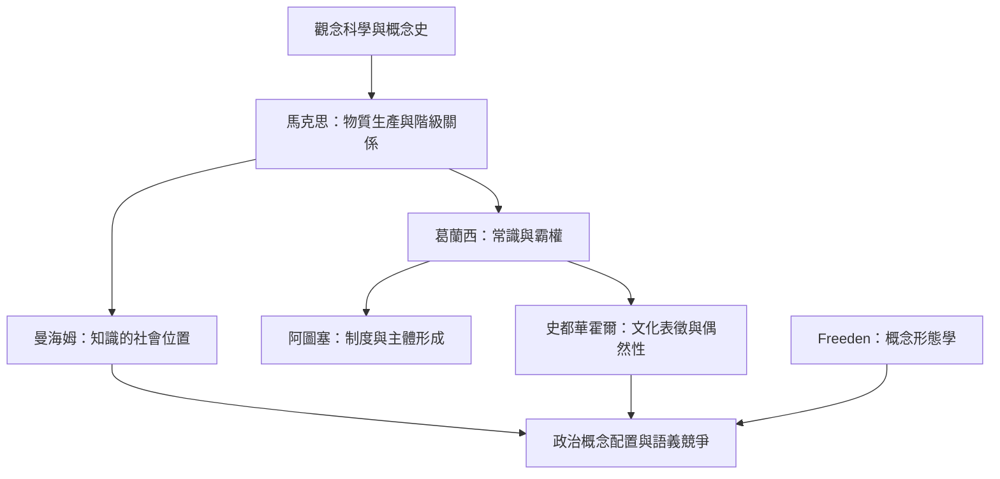

本地圖整理意識形態如何從「觀念科學」轉化為多種政治與社會理論問題。閱讀時可在概念史、知識社會學、物質關係與概念形態學之間往返，而不必假定它們只有一條線性演進路徑。

## 參考
* [[意識形態從觀念科學轉為政治批判]]、[[馬克思將意識形態放回物質生產與階級關係]]、[[曼海姆指出知識與社會位置不可分離]]。
* [[葛蘭西以霸權解釋支配如何取得日常同意]]、[[阿圖塞把意識形態連到制度儀式與主體形成]]、[[史都華霍爾主張意識形態分析不能依賴歷史保證]]。
* [[Freeden以概念形態學研究意識形態]]。
* 概念詞條：[[意識形態]]、[[世界觀]]、[[虛假意識]]、[[知識社會學]]、[[概念形態學]]、[[政治概念]]、[[烏托邦]]。
