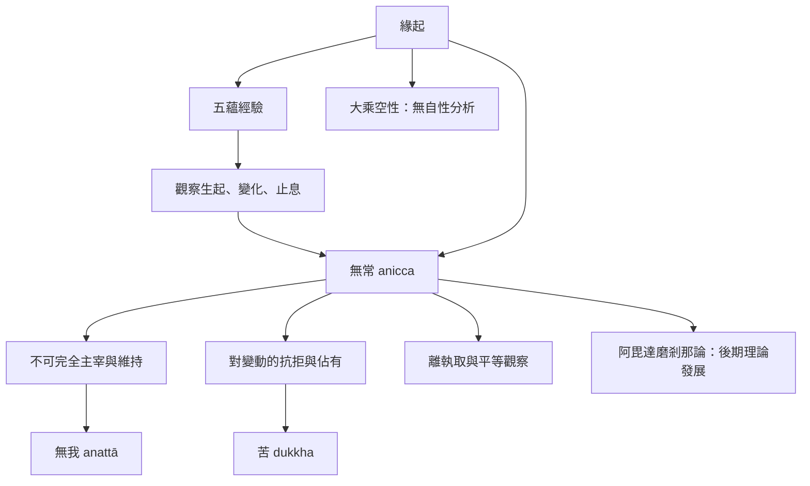

本圖整理佛教脈絡中無常、五蘊、緣起、苦與無我的關係。路徑不是要求讀者先接受形上學，而是從可觀察的身心現象出發，理解它們依條件生起與止息，並檢視執取如何形成額外痛苦。不同佛教部派對剎那生滅與空性的理論化有所差異，圖中將其列為延伸分支，而非等同於早期經典的原始表述。

## 參考
* [[data/早期佛教以五蘊的無常引導人鬆開我與我所的執取]]
* [[data/阿毘達磨將無常分析為剎那生滅但這不是唯一解讀]]
* [[data/巴利經典中的無常不宜簡化為每件事都在快速流動]]
* [[note/無常不是變化的抽象口號而是身心經驗可被觀察的事實]]
* [[note/無常與無我互相照亮但不能直接畫上等號]]
* [[idea/用身體感受練習把無常從信念變成直接觀察]]
