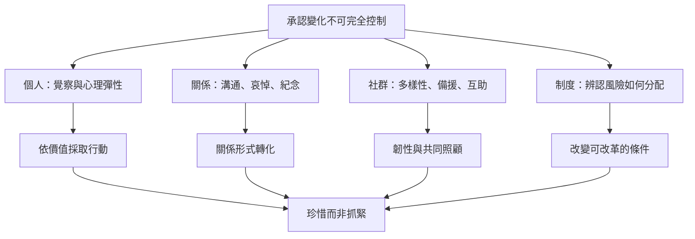

本圖將無常轉為生活倫理：個人層次練習覺察、接納與價值行動；關係層次允許哀悼與持續連結；社群層次建立韌性與共同照顧；制度層次辨認哪些不穩定是權力與資源分配造成的。接受不可避免的變化，不代表接受可被改變的不公。

## 參考
* [[data/心理彈性研究支持接納與價值行動但不保證無痛]]
* [[data/哀傷研究顯示與逝者的持續連結可能同時帶來安慰與困擾]]
* [[data/液態現代性把不穩定視為制度與權力條件而非純自然事實]]
* [[note/生命的轉化需要哀悼而不只是放下]]
* [[note/現代社會的不穩定不應被自然化為無常]]
* [[idea/把關係照顧從佔有轉為共同回應變動]]、[[idea/以生態韌性思考社群如何面對衝擊]]、[[idea/警惕資本主義把不安全感包裝成個人適應力問題]]
