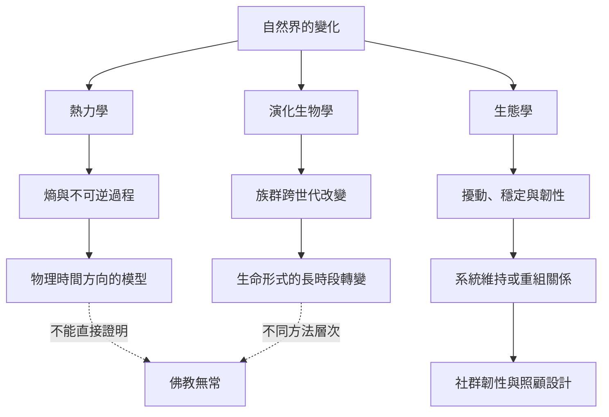

自然科學不會提供一個單一的「無常理論」，而是從不同尺度研究變化：熱力學討論系統狀態與不可逆過程；演化生物學研究族群在世代間的遺傳變化；生態學研究擾動、穩定與韌性。這些成果能豐富我們對時間與持續性的理解，但不能直接證明宗教或哲學命題。

## 參考
* [[data/熵增描述熱力學方向性但不能直接證明佛教無常]]
* [[data/演化改變的是族群而非單一個體]]
* [[data/生態韌性研究把持續性理解為關係延續而非狀態不變]]
* [[note/科學描述與修行洞見必須保持方法論界線]]
* [[note/韌性不是回到原狀而是重組關係並繼續生長]]
* [[term/熵是描述狀態分布與能量可用性的物理量]]、[[term/演化是族群遺傳組成跨世代的改變]]、[[term/韌性是系統在擾動下維持或重組關鍵功能的能力]]
