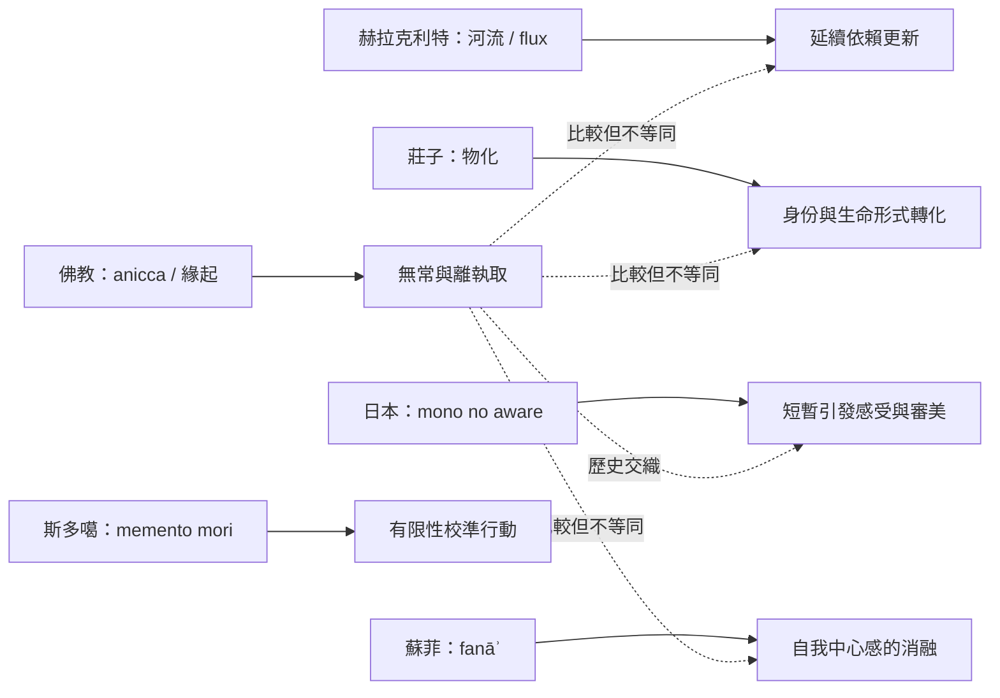

本圖並列不同文化中的變化思想：古印度佛教以無常與緣起分析經驗及執取；古希臘赫拉克利特透過河流思考持續與變化；中國莊子以物化與寓言鬆動固定身份；日本物哀將短暫轉成審美感受；斯多噶派以死亡意識校準德性；蘇菲主義以法那描述自我中心感的消融。這些傳統有交會與影響，也有不同的世界觀與終極關懷，不能互相等同。

## 參考
* [[data/早期佛教以五蘊的無常引導人鬆開我與我所的執取]]
* [[data/赫拉克利特的河流譬喻指出延續可能依賴變化]]
* [[data/莊子以物化與生死轉化鬆動固定身份]]
* [[data/日本物哀讓短暫成為審美與情感的來源]]
* [[data/斯多噶派以死亡意識提醒人把德性落實在今天]]
* [[data/蘇菲主義以法那描述自我中心感的消融]]
* [[term/流變指出事物的延續與持續變化密不可分]]、[[term/物化是萬物與生命形式持續轉化的觀點]]、[[term/物哀是因事物短暫而生的情感與審美敏感]]
