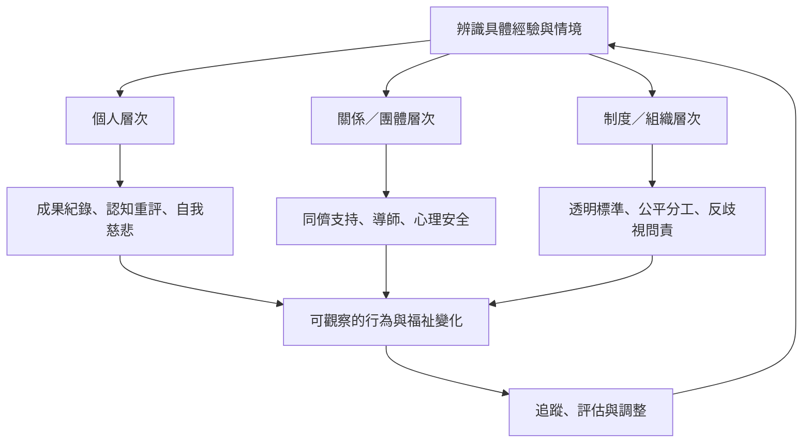

介入不應只要求個人更有自信。個人可以改善自我觀察與成功歸因；團體可以建立支持、回饋與歸屬；組織則要處理隱性規則、評價制度與不公平互動。三個層次彼此補充。

核心連結：[[介入策略需要同時考慮個人與環境]]、[[團體支持能讓自我懷疑從秘密變成可討論的經驗]]、[[自我慈悲能讓錯誤成為資訊而不是羞辱]]、[[用正念觀察冒名頂替念頭而不立即相信它]]、[[建立同儕對話讓自我懷疑不再只能獨自承受]]、[[為新進成員設計清楚的隱性規則導覽]]。

研究依據：[[隨機對照研究為教練式介入降低冒名頂替感提供初步證據]]、[[介入範疇回顧把教育支持與團體支持列為重要方向]]、[[2026 年傘狀回顧指出概念與測量尚未達成共識]]。
