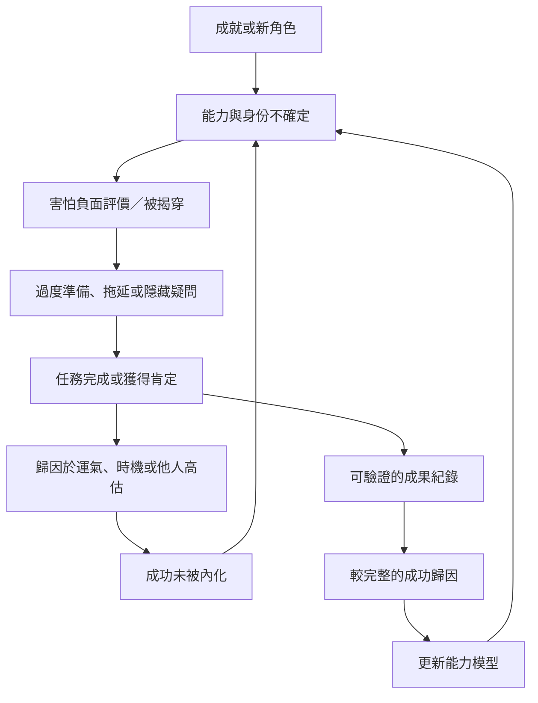

這張地圖把冒名頂替感的心理歷程拆成可觀察的環節：成就與新任務、對成功的歸因、害怕評價、過度準備或逃避，以及再次折扣成果。它不是每個人都會經歷的固定公式，而是一個用來辨認個別循環的工作模型。

核心連結：[[冒名頂替感是一種成功與自我認知不一致的經驗]]、[[冒名頂替感會透過折扣成功而形成自我強化循環]]、[[成功歸因會影響一個人能否把成果內化]]、[[完美主義憂慮比高標準本身更貼近冒名頂替感]]、[[反芻會讓一次失誤變成對整體自我的判決]]、[[建立成功證據帳本而不是只記錄失誤]]、[[用事件紀錄辨認冒名頂替感出現的情境]]。

研究依據：[[冒名頂替現象最初被描述為高成就女性難以內化成功的經驗]]、[[實驗研究發現冒名頂替感與把正面回饋歸因於外在因素有關]]、[[完美主義統合分析指出冒名頂替感更接近完美主義憂慮]]。
