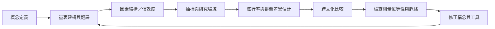

此圖整理研究者如何從個案與量表發展出跨族群、跨地區的研究。研究的核心限制是：構念定義不一、量表不完全等值、抽樣品質不一，且不同地區的資料密度落差大。因此，跨國百分比不應被直接當成文化排名。

核心連結：[[盛行率數字必須連同量表與抽樣方法一起閱讀]]、[[量表分數不是一個人的完整經驗]]、[[全球資料的空白不代表某地沒有這種經驗]]、[[文化差異應被視為研究假設而非刻板印象]]。

研究依據：[[臺灣碩士論文驗證中文版 Clance 短版量表的三因素結構]]、[[香港與英國研究以縱貫資料檢驗冒名頂替感與憂鬱症狀]]、[[印度大學生研究呈現冒名頂替感與學習動機的關聯]]、[[2026 年醫學教育統合分析顯示高盛行率伴隨極高異質性]]、[[2026 年全球醫學生統合分析呈現跨地區比例與性別結果的差異]]。
