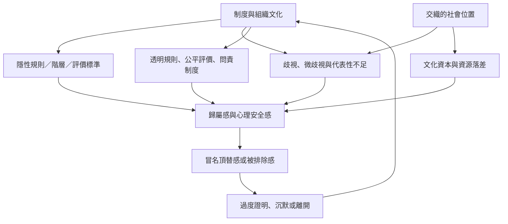

這張地圖將個人感受放回制度情境。冒名頂替感可能來自內在自我評價，也可能被排除、刻板印象、隱性規則與不平等的評價制度放大。制度性冒名化概念強調，機構本身可能持續生產「你不屬於這裡」的訊息。

核心連結：[[制度性冒名化比個人冒名頂替感更能指出權力來源]]、[[交織性分析能避免把少數群體當成單一經驗]]、[[文化差異應被視為研究假設而非刻板印象]]、[[歸屬感會影響個人如何解讀自己的能力]]、[[心理安全感使人能在不受羞辱下承認不知道]]、[[進行制度性冒名化稽核而不只開自信工作坊]]。

研究依據：[[少數族裔研究要求把種族化處境納入冒名頂替現象理論]]、[[有色人種女性學者訪談提出制度性冒名化的概念]]、[[社會學研究把冒名頂替感連到階級再製與象徵權力]]、[[原住民族 STEM 研究揭示文化不被理解如何削弱歸屬感]]。
