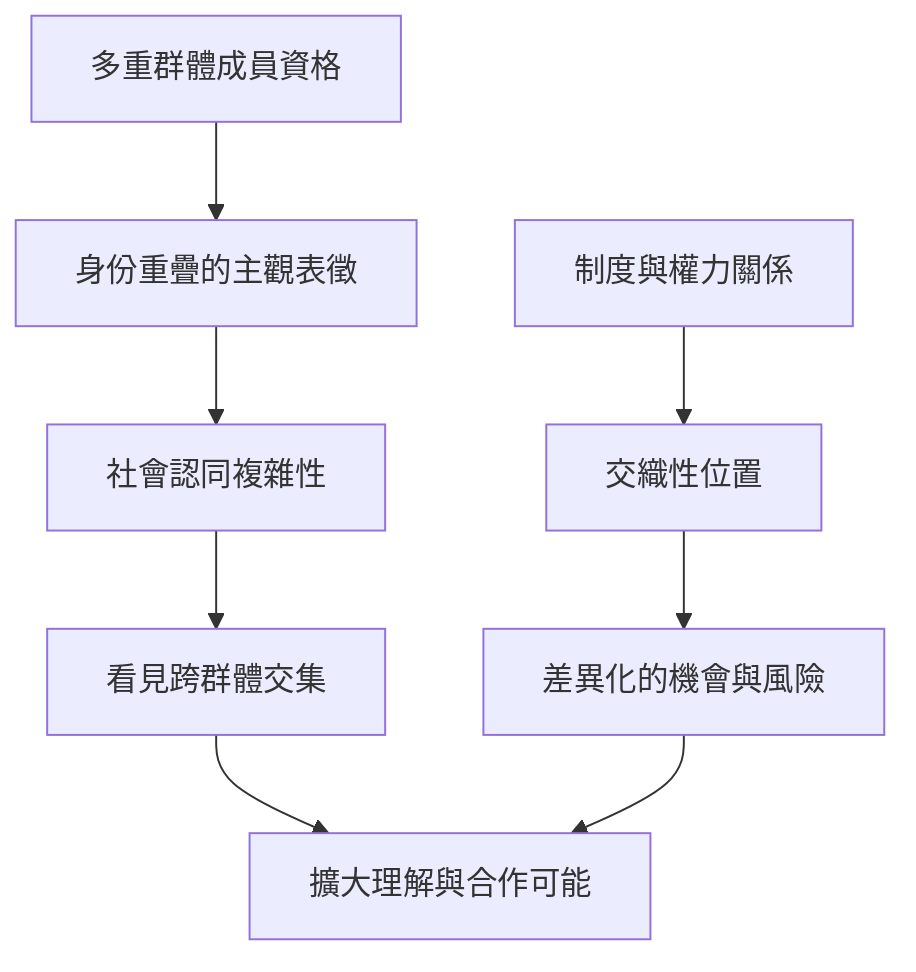

多重身份的交疊使人能看見群體邊界並非封閉；交織性則指出身份位置與權力關係如何共同塑造差異化經驗。兩者有交集，但不相同：社會認同複雜性聚焦個人如何表徵多個內群體的重疊，交織性聚焦權力制度如何在身份交會處運作。

從[[多重身份交疊讓人看見群體邊界並非封閉]]開始，接續[[交織性揭示單一身份分類如何抹除邊緣經驗]]、[[群體認同同時滿足歸屬與差異]]。概念包括[[社會認同複雜性]]、[[交織性]]、[[最適差異化理論]]與[[雙重身份]]。

全書脈絡：[[In-group_and_out-group]]。
