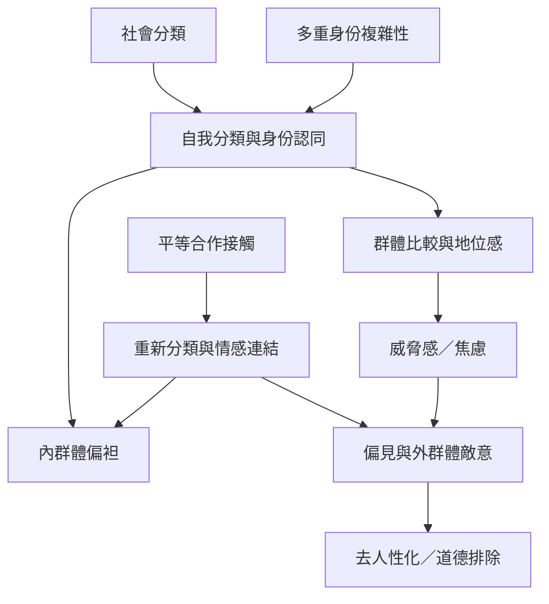

內群體／外群體的心理機制可從社會分類開始，經由身份認同、群體比較、威脅感與情緒反應，形成偏袒、偏見或合作。這條路徑不是必然的單向流程；情境規範、個人多重身份與群際接觸都可能改變結果。

相關論述可從[[內群體和外群體是關係性分類而非固定本質]]開始，接著閱讀[[分類本身可引發偏袒但不等於必然仇恨]]、[[群體認同同時滿足歸屬與差異]]、[[威脅感是客觀利益與象徵解讀相互作用的結果]]與[[分類如何可能走向道德排除與去人性化]]。核心概念包括[[社會分類]]、[[社會認同理論]]、[[自我分類理論]]、[[最小群體典範]]、[[群體威脅理論]]、[[內群體偏袒]]與[[去人性化]]。

全書脈絡：[[In-group_and_out-group]]。
