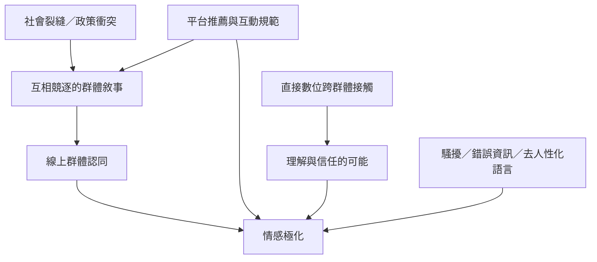

數位平台同時提供跨群體接觸與群體動員的基礎設施。共同敘事能強化身份認同，對立敘事則使群體間心理距離增加；演算法、社群規範、匿名程度與接觸品質都會介入這個過程。

閱讀[[數位敘事會加速我們與他們的政治分化]]、[[數位跨群體接觸可能降低偏見但效果有限且有條件]]與[[分類如何可能走向道德排除與去人性化]]。概念包括[[情感極化]]、[[數位跨群體接觸]]、[[群體威脅理論]]與[[去人性化]]。

全書脈絡：[[In-group_and_out-group]]。
