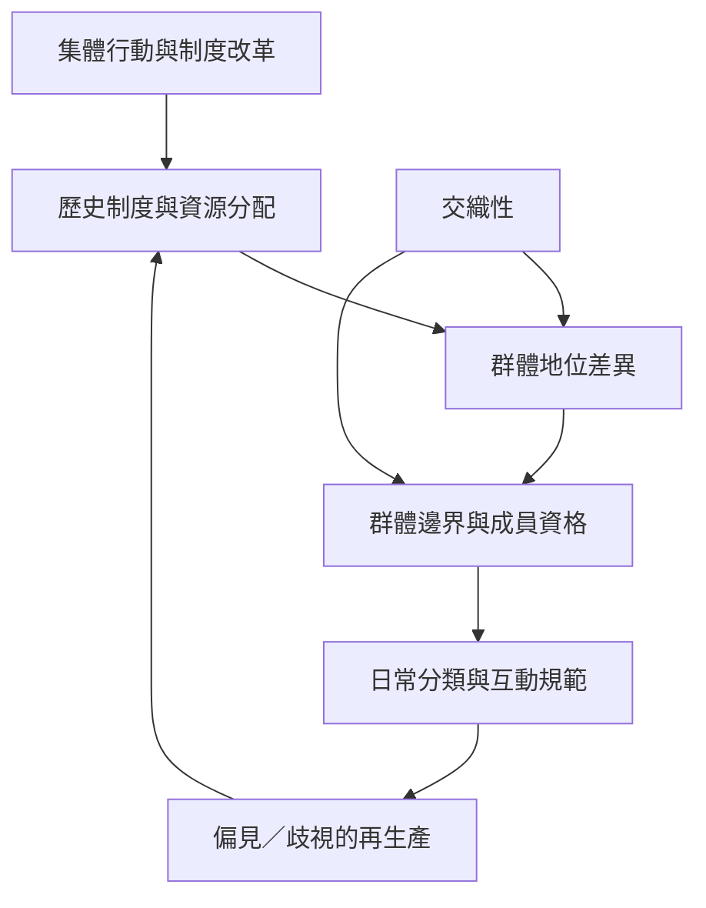

群體邊界會嵌入制度與歷史，不只是個人認知。殖民、種族隔離、種姓秩序、國家建構與資源分配會改變不同群體維持身份的成本。交織性也提醒，任何群體內部都有不同權力位置。

以[[群體地位與權力決定群體邊界的成本]]作為主線，參照[[族群邊界是在互動中維持而非由文化差異自動決定]]、[[印度種姓偏見與群體位置及身份榮耀有關]]、[[南非後種族隔離世代的群際關係仍受歷史與階級形塑]]與[[台灣跨海峽接觸與政治脈絡共同形塑身份認同]]。核心概念包括[[族群邊界]]、[[交織性]]、[[社會支配理論]]、[[制度正當化]]與[[歧視]]。

全書脈絡：[[In-group_and_out-group]]。
