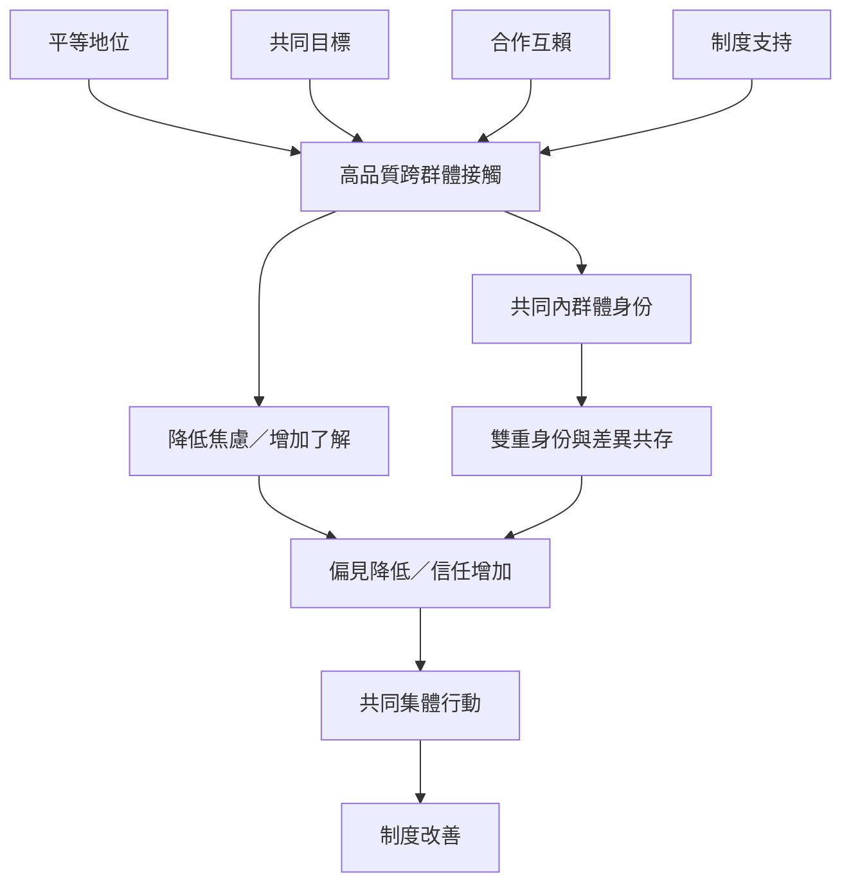

跨群體接觸可透過合作與情感連結降低偏見，但成效取決於地位平等、共同目標、制度支持與接觸品質。共同身份能降低邊界感，雙重身份則讓共同性與差異並存。接觸也必須與集體行動和制度公平連結。

建議閱讀[[跨群體接觸需要平等合作與制度支持才較可能降低偏見]]、[[共同身份與群體差異共存比強迫同化更可持續]]、[[接觸不能取代對結構性不平等的處理]]與[[道德共同體可透過共同目標逐步擴展]]。核心概念包括[[跨群體接觸]]、[[延伸接觸]]、[[共同內群體身份模型]]、[[雙重身份]]、[[超級目標]]與[[集體行動]]。

全書脈絡：[[In-group_and_out-group]]。
