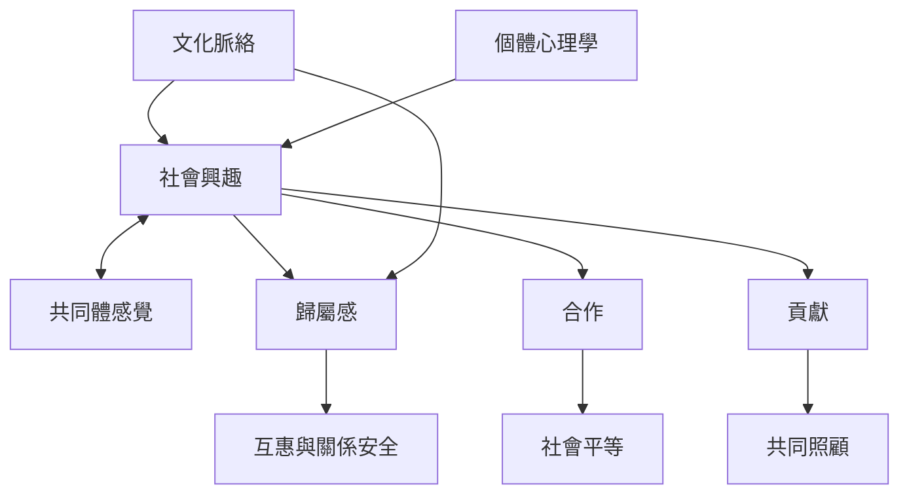

個體心理學把人格放在社會脈絡中理解。共同體感覺並非服從群體，而是能在平等關係中建立歸屬、互惠與貢獻。此圖同時提示：文化會影響人們如何理解自主、責任與歸屬。

閱讀路徑：[[社會興趣]] → [[共同體感覺]] → [[歸屬感]] → [[合作]] → [[互賴]]。

延伸永久筆記：[[社會興趣衡量的是合作與共同福祉而非討好]]、[[歸屬感需要同時經驗被接納與能夠貢獻]]、[[文化脈絡決定共同體與獨立如何被理解]]、[[個體心理學可與互賴觀形成對話而非直接等同]]。

回到全書：[[Individual_psychology]]。
