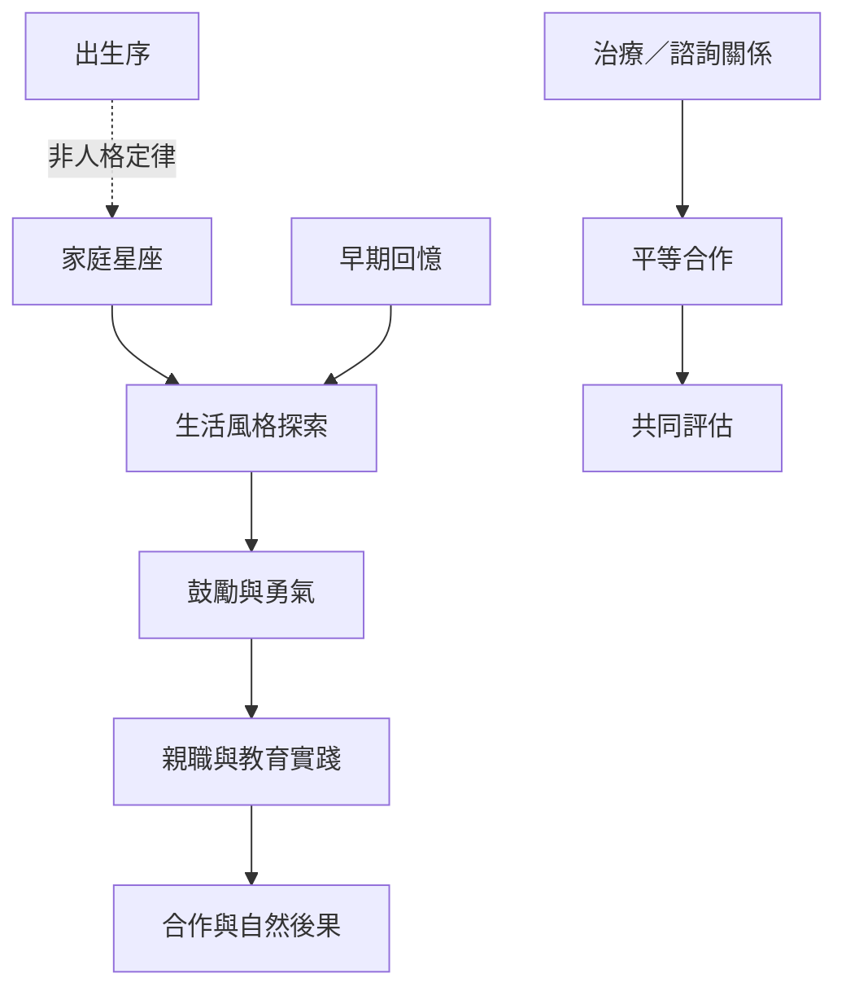

此圖將阿德勒理論連結到家庭、學校與諮商。家庭星座與早期回憶是探索線索，不是命定分類；鼓勵、平等合作與共同理解則是可被實踐和評估的工作原則。

閱讀路徑：[[家庭星座]] → [[生活風格]] → [[鼓勵]] → [[勇氣]] → [[生活任務]]。

延伸永久筆記：[[家庭星座描述情境位置而不是人格命運]]、[[早期回憶可作為生命故事線索但不能視為錄影檔]]、[[諮商關係應建立在平等合作與共同理解]]、[[公共預防把心理健康從個人治療擴展到制度設計]]。

回到全書：[[Individual_psychology]]。
