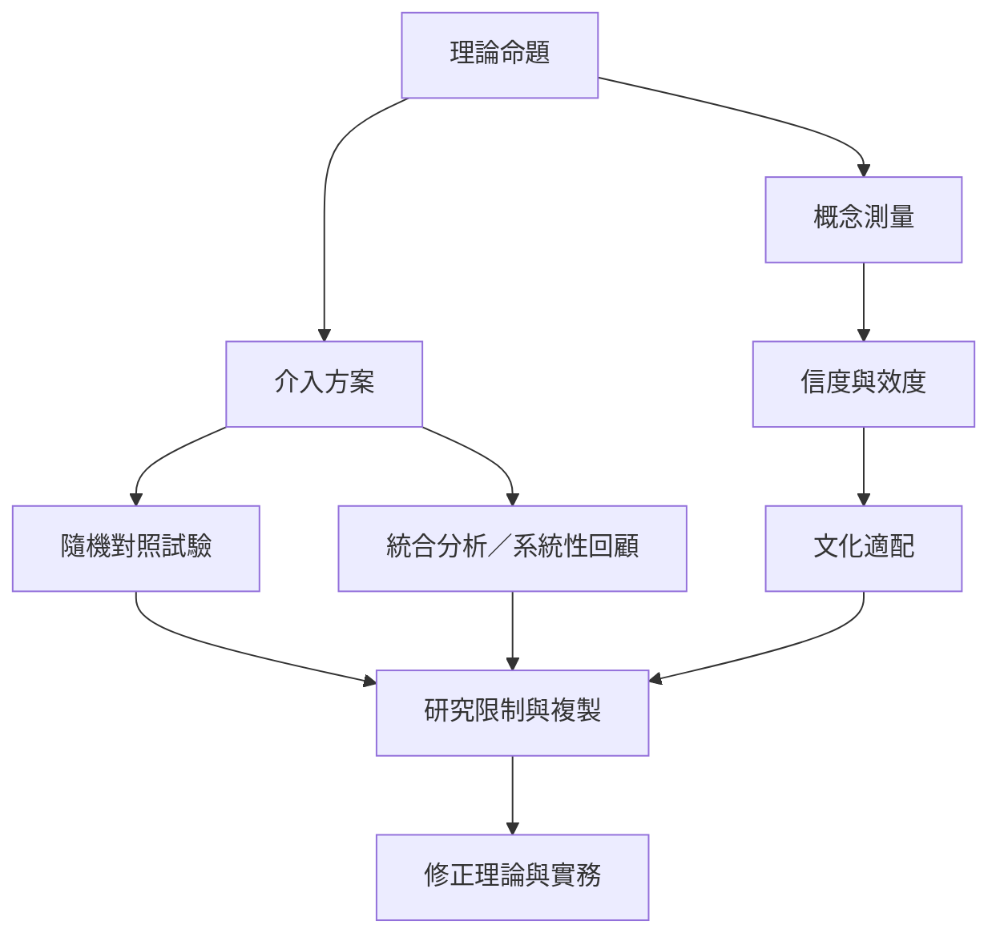

此圖把理論主張、測量工具與介入研究分開。量表信效度、心理治療成效及理論命題的支持程度是不同層級的問題。現有研究為某些兒童與教育方案提供希望，但不能把局部介入成效擴大成整套人格理論的驗證。

閱讀路徑：[[阿德勒介入的實證支持集中於特定教育與兒童方案]] → [[日本研究把共同體感覺轉化為可測量構念]] → [[社會興趣量表的修訂揭示概念測量仍需校正]] → [[2026年校園隨機試驗支持團體阿德勒遊戲治療的潛力]]。

延伸永久筆記：[[測量共同體感覺需要文化敏感且效度清晰]]、[[女性平等是個體心理學的社會倫理資源]]、[[個體心理學可與互賴觀形成對話而非直接等同]]。

回到全書：[[Individual_psychology]]。
