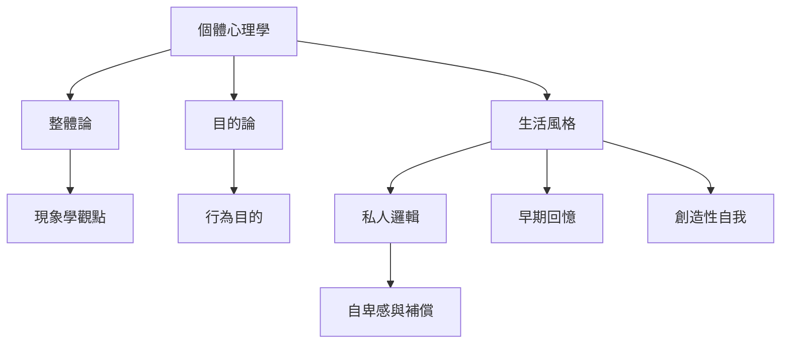

本概念地圖聚焦個體心理學如何理解人：個體是一個不可分割的整體，會以主觀目標組織經驗，並透過生活風格與私人邏輯回應世界。閱讀此圖時，先掌握理論假設，再辨識哪些是解釋框架、哪些仍需實證檢驗。

閱讀路徑：[[個體心理學]] → [[整體論]] → [[目的論]] → [[生活風格]] → [[私人邏輯]] → [[早期回憶]]。

延伸永久筆記：[[阿德勒的個體不是孤立的心靈而是社會關係中的整體]]、[[行為可被理解為朝向某種主觀目的的策略]]、[[生活風格是一套持續組織經驗與選擇的導航方式]]、[[私人邏輯讓人把局部經驗誤當普遍規則]]。

回到全書：[[Individual_psychology]]。
