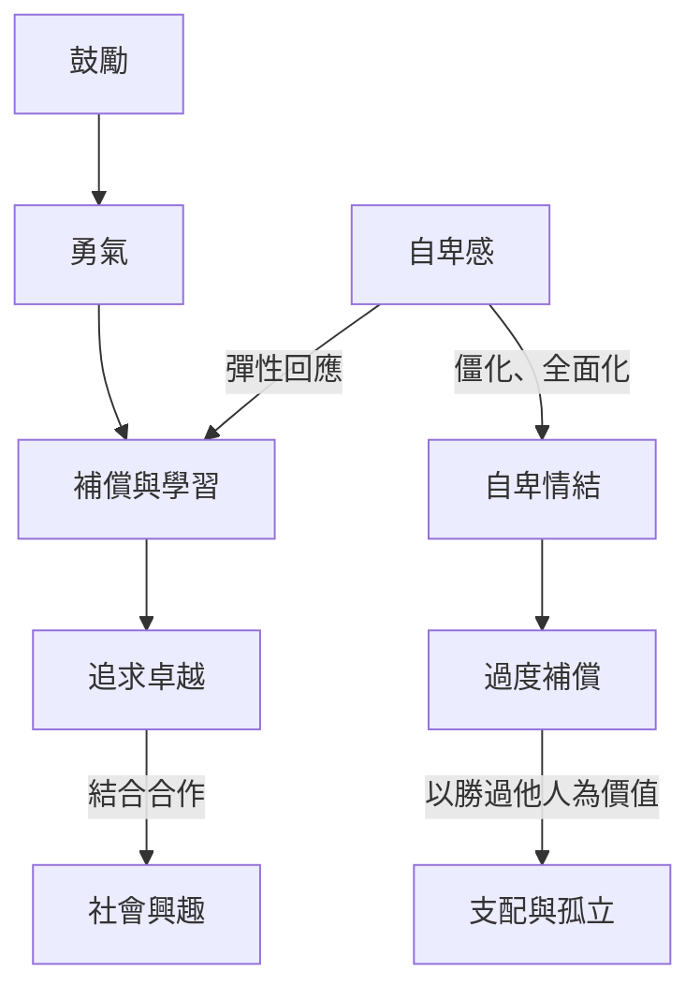

此圖呈現自卑感如何成為行動起點，以及追求卓越、補償與鼓勵可能形成的不同路徑。核心不是消除所有不足，而是避免把不足感固定成身份判決，並讓成長回到合作而非支配。

閱讀路徑：[[自卑感]] → [[補償]] → [[追求卓越]] → [[社會興趣]]，並對照[[自卑情結]]與[[鼓勵]]。

延伸永久筆記：[[自卑感是人類經驗而自卑情結是僵化的無力模式]]、[[追求優越可以是成長也可能變成支配]]、[[鼓勵重建的是行動勇氣而非獎賞表現]]。

回到全書：[[Individual_psychology]]。
