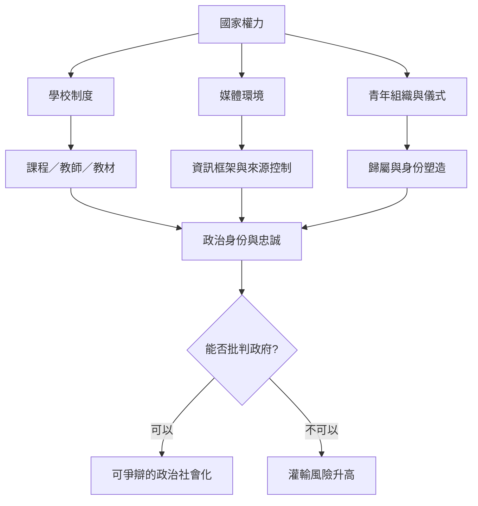

政治灌輸可能透過國家課程、教師任用、青年組織、媒體控制與愛國儀式形成。比較時要把制度能力、傳播內容與公民能否批判掌權者分開。連結[[政治社會化]]、[[宣傳]]、[[民族主義]]、[[意識形態]]與[[隱性課程]]。

## 思與行
* 以 V-Indoc 的制度視角比較不同國家，但須補充在地經驗與資料限制。

## 參考
* [[跨國比較研究顯示灌輸同時存在於教育制度與媒體環境]]；[[納粹德國透過學校青年組織與日常生活塑造服從者]]；[[明治日本以教育敕語把國家忠誠制度化為學校道德]]；[[中國愛國主義教育法把國家認同教育擴展為全社會任務]]。
