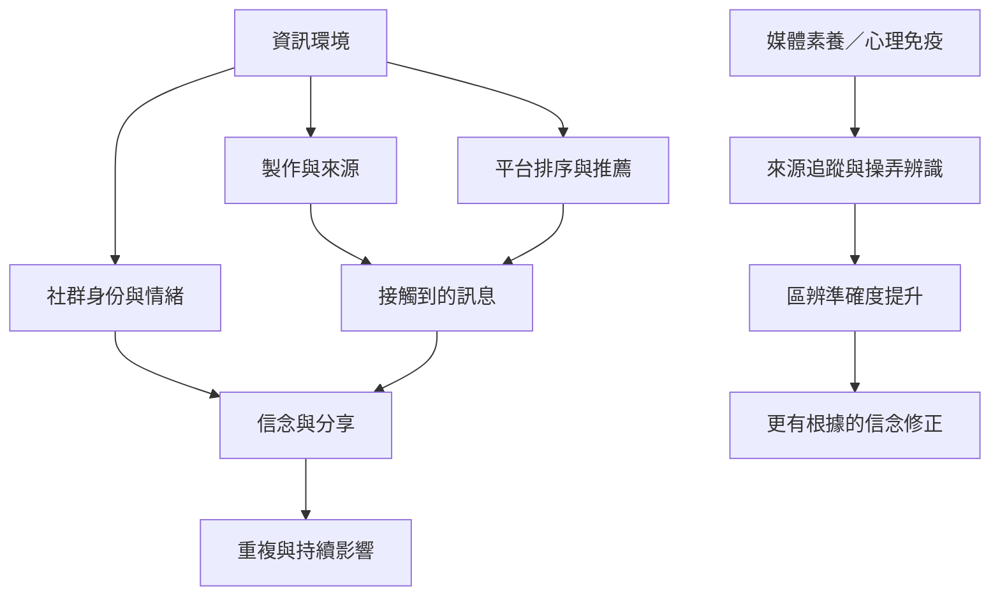

數位平台將來源、排序、重複與社群身份結合，使資訊環境成為信念形成的重要條件。反制策略應提升辨識與查證，而不是訓練普遍懷疑。連結[[媒體素養]]、[[心理免疫]]、[[錯誤資訊]]、[[資訊操控]]與[[持續影響效應]]。

## 思與行
* 把事前心理免疫、事後更正與跨來源查證視為不同工具，依問題選擇，不以單一工具包辦所有風險。

## 參考
* [[錯誤資訊的更正通常無法完全消除原先形成的信念影響]]；[[2026年統合分析顯示心理免疫可提升辨識而不必增加普遍猜疑]]；[[教科文組織媒體與資訊素養課程把批判查證連結到數位公民能力]]；[[盧安達仇恨廣播研究顯示識字與替代資訊可能削弱宣傳效果]]。
