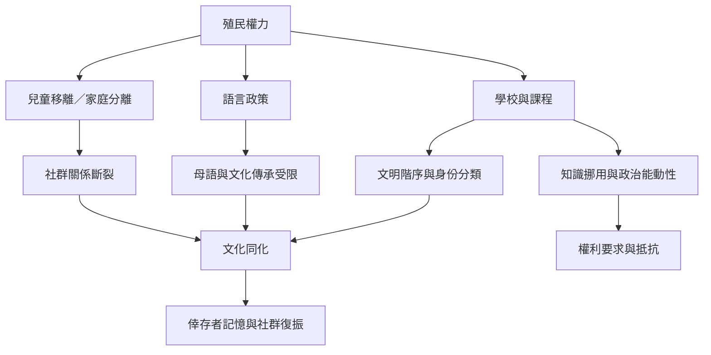

殖民教育可以透過語言、課程、兒童移離與資源分配改造集體身份，也可能被受教者挪用為權利論述與反殖民行動。連結[[殖民主義]]、[[文化同化]]、[[公共記憶必須讓當事人參與知識生產]]與[[認知自主]]。

## 思與行
* 把官方制度文件與社群自述放在一起，辨認制度語言如何遮蔽個人經驗。

## 參考
* [[加拿大寄宿學校以強制分離兒童達成文化同化]]；[[澳洲 Bringing Them Home 報告以倖存者證言揭露兒童強制移離]]；[[南非班圖教育以種族隔離限制黑人學生的知識與機會]]；[[英國殖民印度教育史必須同時檢視政策目標與在地能動性]]；[[法國殖民阿爾及利亞教育把文明使命與種族化治理連結]]。
